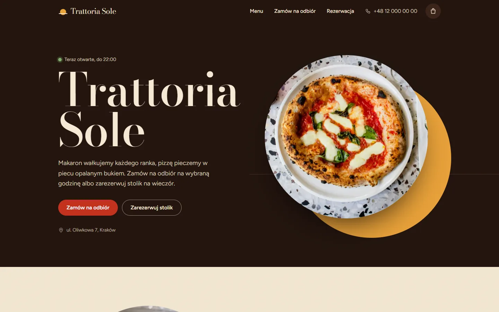
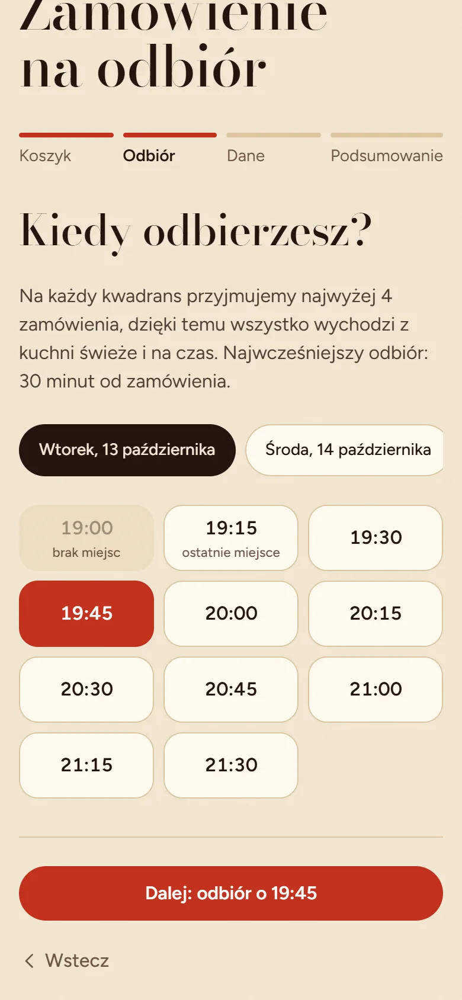
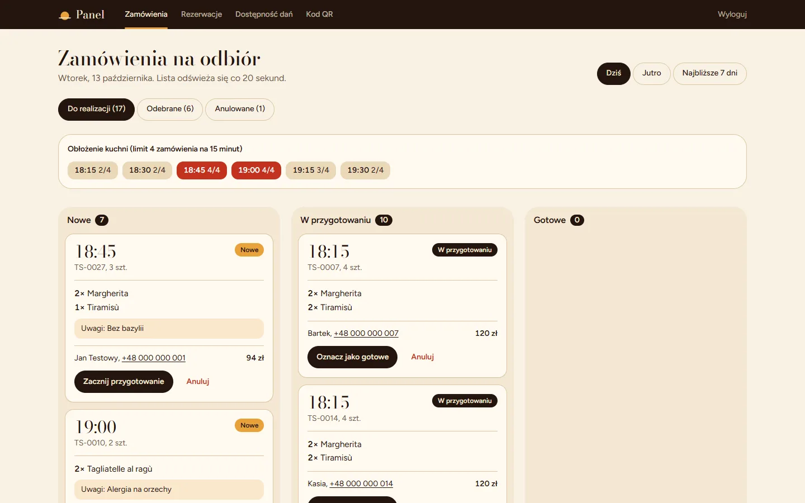

# Case study: Trattoria Sole

**Strona restauracji z zamówieniami na odbiór, rezerwacjami i panelem dla obsługi**

> Projekt demonstracyjny. Trattoria Sole to fikcyjna restauracja, ale problem, który rozwiązuje strona, jest prawdziwy: tak wygląda piątkowy wieczór w wielu małych lokalach.

## Problem

Rodzinna trattoria, około 40 miejsc, pizza z pieca i świeży makaron. Zamówienia na wynos przyjmowane są wyłącznie przez telefon.

W godzinach szczytu (piątek i sobota, 18:00–20:00) wygląda to tak:

- **Telefon dzwoni bez przerwy.** Ktoś z sali odbiera go w biegu, zapisuje zamówienie na kartce i w tym czasie nie obsługuje gości przy stolikach.
- **Kuchnia dostaje wszystko naraz.** Nikt nie pilnuje, ile zamówień ma być gotowych na tę samą godzinę, więc o 18:30 piec ma w kolejce kilkanaście pizz, a goście czekają przy ladzie.
- **Zdarzają się pomyłki.** Ktoś usłyszał „diavola” zamiast „margherita”, nie zanotował alergii albo podał złą cenę, bo karta zmieniła się tydzień temu.
- **Goście dzwonią z pytaniami,** które nie wymagają rozmowy: czy macie coś bez glutenu, do której jesteście otwarci, czy jest wolny stolik na ósmą.
- **Menu na stolikach się starzeje.** Zalaminowana karta nie powie, że dziś skończyły się borowiki.

## Rozwiązanie

Strona, która przejmuje rutynową część tej pracy i porządkuje to, co trafia do kuchni.

1. **Menu online z alergenami i filtrami.** Gość na telefonie od razu widzi ceny, numery alergenów i oznaczenia wege, bez glutenu i ostre. Nie musi dzwonić, żeby o to zapytać.
2. **Zamówienia na odbiór z wyborem godziny.** Klient składa zamówienie sam, a system pokazuje tylko te godziny, na które kuchnia realnie zdąży.
3. **Limit zamówień na każde 15 minut.** To kluczowa funkcja. Gdy na 18:45 są już 4 zamówienia, ten termin znika z wyboru, a klient dostaje 19:00. Ruch rozkłada się równo, zamiast spiętrzać na jedną godzinę.
4. **Panel dla obsługi zamiast kartek.** Zamówienia układają się w trzy kolumny: nowe, w przygotowaniu, gotowe. Każde ma godzinę odbioru, pozycje, uwagi („alergia na orzechy”) i telefon klienta. Zmiana statusu to jedno kliknięcie, a klient widzi ją na swojej stronie potwierdzenia.
5. **„Chwilowo niedostępne” jednym przełącznikiem.** Skończył się składnik? Obsługa wyłącza danie w panelu i znika ono z zamówień, a w menu pojawia się odpowiednia informacja.
6. **Rezerwacje online** z limitem miejsc na każde pół godziny i potwierdzaniem w panelu.
7. **Kod QR na stolikach** prowadzi do aktualnego menu, zawsze z bieżącą dostępnością dań.

| Wybór godziny odbioru | Panel obsługi |
| --- | --- |
|  |  |

## Funkcje

**Dla gości**

- Menu na telefonie: przyklejony pasek kategorii, filtry (wegetariańskie, bez glutenu, ostre), alergeny z legendą.
- Koszyk zapamiętany w przeglądarce, wybór dnia i godziny odbioru, płatność przy odbiorze (gotówka lub karta).
- Strona potwierdzenia z numerem zamówienia i statusem aktualizowanym na żywo.
- E-mail z potwierdzeniem (opcjonalnie).
- Rezerwacja stolika w kilka sekund.
- Godziny otwarcia z informacją „teraz otwarte, do 22:00”, mapa dojazdu.

**Dla restauracji**

- Panel zamówień z podglądem obłożenia kuchni w najbliższych slotach.
- Powiadomienie e-mail o każdym nowym zamówieniu i rezerwacji.
- Lista rezerwacji pogrupowana po dniach, z potwierdzaniem i anulowaniem.
- Włączanie i wyłączanie dostępności dań.
- Kod QR i gotowa karta na stolik do druku.
- Menu w prostym pliku: zmiana ceny czy opisu nie wymaga programisty.
- Konfigurowalne zasady: długość slotu, limit zamówień, minimalny czas przygotowania, limit miejsc.

**Widoczność w Google**

- Dane strukturalne `Restaurant` i `Menu`, dzięki którym wyszukiwarka rozumie godziny otwarcia, adres, kuchnię, ceny i diety.
- Mapa strony, metadane i obraz do udostępniania w mediach społecznościowych.

## Technologie

- **Next.js 16 + TypeScript:** szybka strona, w której menu jest serwowane jako statyczny plik z CDN, a zmiany dostępności widać mimo to od razu.
- **Tailwind CSS:** projekt mobile-first, bo większość gości przegląda menu na telefonie.
- **Prisma + SQLite (Turso na produkcji):** prosta, tania baza bez serwera do utrzymania.
- **Vercel:** hosting bez administracji. Wdrożenie trwa minuty, a darmowe plany wystarczają małemu lokalowi.
- Bez integracji płatności i bez abonamentu platform zamówieniowych, czyli bez prowizji od każdego zamówienia.

## Efekt

To projekt demonstracyjny, więc nie ma tu wyników z prawdziwego lokalu. Tak wygląda scenariusz, który strona realizuje:

- **Telefon przestaje być jedynym kanałem.** Zamówienia na wynos trafiają do panelu, a obsługa odbiera telefon tylko w nietypowych sprawach.
- **Szczyt jest rozłożony w czasie.** Limit na kwadrans sprawia, że kuchnia przygotowuje tyle, ile jest w stanie wydać na czas. Klient odbiera gorące jedzenie o umówionej godzinie i nie stoi w kolejce.
- **Mniej pomyłek.** Zamówienie jest zapisane dokładnie tak, jak klient je złożył, z cenami z aktualnego menu i z uwagami o alergiach.
- **Mniej pytań przez telefon.** Alergeny, opcje wege i bez glutenu, godziny otwarcia i wolne terminy rezerwacji są na stronie.
- **Aktualne menu na stolikach.** Kod QR zawsze prowadzi do bieżącej wersji, z informacją o daniach chwilowo niedostępnych.

Kolejne kroki, jeśli lokal tego potrzebuje: płatności online (BLIK, Przelewy24), SMS „zamówienie gotowe”, statystyki najpopularniejszych dań i godzin, wersja angielska menu dla turystów.

---

*Masz restaurację, kawiarnię albo pizzerię i podobny problem? Ten projekt można dopasować do Twojego lokalu: menu, zasady zamówień, wygląd i domenę.*
