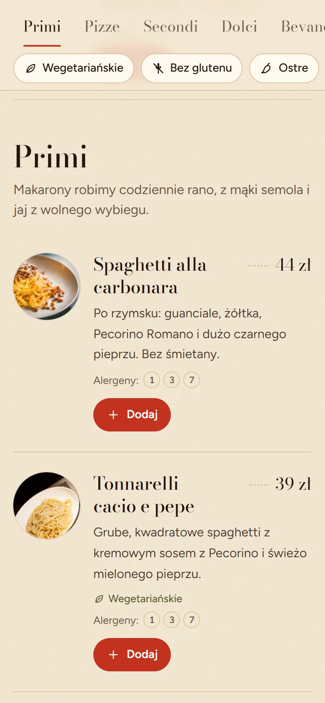
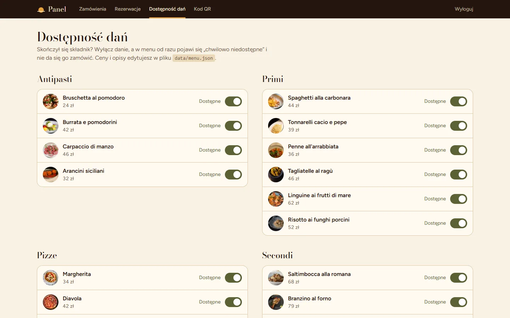

# Trattoria Sole: strona restauracji z zamówieniami na odbiór

Demo strony dla fikcyjnej włoskiej restauracji w Krakowie. Zawiera menu online z alergenami i filtrami, zamówienia na odbiór z limitem zamówień na każde 15 minut, rezerwacje stolików, panel obsługi i kod QR na stoliki.

> **Projekt demonstracyjny.** Restauracja, adres, telefon, e-maile i opinie są fikcyjne. Numer `+48 12 000 00 00` nie istnieje w polskim planie numeracji, a domena `.example` jest zastrzeżona (RFC 2606).

| Strona główna | Menu (telefon) | Wybór godziny odbioru |
| --- | --- | --- |
|  |  |  |

| Panel: zamówienia | Panel: dostępność dań |
| --- | --- |
|  |  |

Opis biznesowy (problem, rozwiązanie, efekt) jest w [CASE_STUDY.md](CASE_STUDY.md).

## Funkcje

- **Strona główna:** hero, historia lokalu, polecane dania, jak działa odbiór, godziny otwarcia z informacją „teraz otwarte”, mapa (OpenStreetMap), opinie, galeria z podglądem.
- **Menu online** (`/menu`): 26 dań w 6 kategoriach, przyklejony pasek kategorii z podświetlaniem bieżącej sekcji, filtry (wegetariańskie, bez glutenu, ostre) zapisywane w adresie URL, numery 14 alergenów UE z legendą, oznaczenie „chwilowo niedostępne”.
- **Zamówienia na odbiór** (`/zamowienie`): koszyk zapamiętany w przeglądarce, wybór dnia i godziny (sloty co 15 min, najwcześniej 30 min od zamówienia, **maks. 4 zamówienia na slot**), dane kontaktowe, podsumowanie, płatność przy odbiorze. Strona potwierdzenia pokazuje status zamówienia na żywo.
- **Rezerwacje** (`/rezerwacja`): data, godzina, liczba osób (do 10 online), telefon. Limit miejsc na każde pół godziny.
- **Panel obsługi** (`/admin`, hasło z `.env`):
  - zamówienia w trzech kolumnach (nowe, w przygotowaniu, gotowe) z obłożeniem kuchni na najbliższe sloty;
  - rezerwacje pogrupowane po dniach, z potwierdzaniem i anulowaniem;
  - włączanie i wyłączanie dostępności dań;
  - kod QR do pobrania.
- **Powiadomienia e-mail:** do kuchni i do klienta. W trybie demo treść maila trafia do logów serwera.
- **Kod QR:** PNG do druku i gotowa karta na stolik A6.
- **SEO:**
  - metadane, OpenGraph, `sitemap.xml`, `robots.txt`, manifest;
  - dane strukturalne `Restaurant` (adres, godziny, `acceptsReservations`, `OrderAction`) oraz `Menu` → `MenuSection` → `MenuItem` (ceny w PLN, `suitableForDiet`).

## Technologie

| | |
| --- | --- |
| Framework | Next.js 16 (App Router, Cache Components, Server Actions, Proxy) |
| Język | TypeScript |
| Style | Tailwind CSS 4, fonty Bodoni Moda + Figtree (`next/font`) |
| Baza | Prisma 7 + libSQL: lokalnie plik SQLite, na produkcji Turso |
| Walidacja | Zod 4 (formularze i plik menu) |
| Inne | `qrcode`, `nodemailer`, `sharp`, Vitest |
| Hosting | Vercel |

Kilka decyzji wartych uwagi:

- **Ceny zawsze liczy serwer.** Przeglądarka wysyła tylko id dań i ilości, a serwer wycenia koszyk z `menu.json` i sprawdza dostępność oraz limit slotu w jednej transakcji.
- **Strona menu jest statyczna** (prerender + cache). Wyłączenie dania w panelu unieważnia cache przez `updateTag`, więc goście widzą zmianę od razu, a strona dalej ładuje się z CDN.
- **Wszystkie godziny liczone są w strefie `Europe/Warsaw`**, niezależnie od strefy serwera (Vercel działa w UTC), z obsługą zmiany czasu. Pokrywają to testy.
- **Sesja panelu** to podpisany HMAC token w ciasteczku `HttpOnly`. Proxy tylko przekierowuje niezalogowanych, a każda akcja i strona panelu sprawdza sesję osobno.

## Uruchomienie lokalne

Wymagany Node.js 20.9+.

```bash
npm install                 # instaluje zależności i generuje klienta Prisma
cp .env.example .env        # uzupełnij ADMIN_PASSWORD i ADMIN_SESSION_SECRET
npx prisma migrate dev      # tworzy lokalną bazę dev.db
npm run db:seed             # przykładowe zamówienia i rezerwacje do panelu
npm run dev                 # http://localhost:3000
```

Panel: `http://localhost:3000/admin`, hasło z `ADMIN_PASSWORD`.

Sekret sesji wygenerujesz poleceniem:

```bash
node -e "console.log(require('crypto').randomBytes(32).toString('hex'))"
```

## Edycja menu

Całe menu jest w [`data/menu.json`](data/menu.json). Każde danie ma postać:

```json
{
  "id": "pizza-margherita",
  "category": "pizze",
  "name": "Margherita",
  "description": "Pomidory San Marzano, fior di latte, bazylia i oliwa.",
  "price": 3400,
  "image": "/images/dishes/pizza-margherita.webp",
  "vegetarian": true,
  "vegan": false,
  "glutenFree": false,
  "spicy": 0,
  "allergens": ["gluten", "milk"],
  "featured": false
}
```

- `price` podajesz w groszach (`3400` = 34 zł).
- `spicy`: 0–3.
- `allergens`: klucze z sekcji `allergens` (14 alergenów UE).
- `dineInOnly: true` oznacza danie tylko na sali, np. alkohol.

Plik jest walidowany przy każdym `npm run dev` i `npm run build`. Literówka w kategorii albo alergenie zatrzyma build z czytelnym komunikatem.

Dostępność dań („chwilowo niedostępne”) zmienia obsługa w panelu, bez edycji pliku.

Dane lokalu (adres, godziny, limity zamówień i rezerwacji) są w [`data/restaurant.ts`](data/restaurant.ts):

```ts
pickup: { slotMinutes: 15, leadMinutes: 30, maxOrdersPerSlot: 4, daysAhead: 3, ... }
reservations: { slotMinutes: 30, maxGuestsPerSlot: 36, maxGuestsOnline: 10, ... }
```

## Zdjęcia

Zdjęcia pochodzą z Unsplash (licencja Unsplash). Autorzy są wymienieni w [`data/image-credits.json`](data/image-credits.json) i na stronie `/zdjecia`.

- `npm run images` pobiera brakujące zdjęcia i zapisuje je jako WebP.
- `npm run images -- --force` pobiera wszystkie od nowa.

Własne zdjęcia: podmień pliki w `public/images/` (te same nazwy) i usuń odpowiednie wpisy z `image-credits.json`.

## Kod QR

```bash
NEXT_PUBLIC_SITE_URL=https://twoja-domena.pl npm run qr
```

Tworzy `public/qr/menu-qr.png` (1200 px, korekcja błędów H) oraz `public/qr/karta-stolik.png` (A6, 300 dpi). Kod prowadzi do `/menu?utm_source=qr&utm_medium=stolik`, dzięki czemu wejścia ze stolików widać w statystykach.

Sam kod QR dla bieżącej domeny można też pobrać w panelu, w zakładce „Kod QR”.

## E-maile

| `MAIL_MODE` | Działanie |
| --- | --- |
| `console` (domyślnie) | Treść maili do kuchni i do klienta trafia do logów serwera. To tryb demo. |
| `smtp` | Wysyłka przez `SMTP_HOST`, `SMTP_PORT`, `SMTP_USER`, `SMTP_PASS`. Adres kuchni ustawiasz w `RESTAURANT_EMAIL`. |

Mail wysyłany jest po odpowiedzi (`after()`), więc klient nie czeka na serwer SMTP. Błąd wysyłki nie cofa przyjętego zamówienia.

## Wdrożenie: Vercel + Turso

Plik SQLite nie przetrwa na Vercel, bo system plików funkcji jest tylko do odczytu i ulotny. Dlatego produkcja używa [Turso](https://turso.tech): to libSQL, czyli SQLite w chmurze, z tym samym schematem i tym samym adapterem.

Zmienne produkcyjne trzymasz w pliku `.env.vercel` (nie trafia do Gita). Skrypty `*:prod` czytają go automatycznie.

1. Skopiuj `.env.example` do `.env.vercel` i ustaw `ADMIN_PASSWORD` oraz nowy `ADMIN_SESSION_SECRET`.
2. W panelu [app.turso.tech](https://app.turso.tech) utwórz bazę (region Frankfurt) i wygeneruj token. Wpisz adres `libsql://…` i token do `.env.vercel` jako `DATABASE_URL` i `DATABASE_AUTH_TOKEN`.
3. Załóż tabele i (opcjonalnie) wgraj dane demo:
   ```bash
   npm run db:deploy:prod
   npm run db:seed:prod
   ```
   `db:deploy` stosuje pliki z `prisma/migrations`. Zastępuje `prisma migrate deploy`, który nie łączy się z `libsql://`. Można go uruchamiać wielokrotnie.
4. W Vercel: **Add New → Project**, zaimportuj repozytorium. W **Environment Variables** wklej całą zawartość `.env.vercel` w pierwsze pole, a Vercel sam rozbije ją na zmienne. Kliknij **Deploy**.
5. Po wdrożeniu wpisz adres strony do `NEXT_PUBLIC_SITE_URL` (w `.env.vercel` i w Vercel), zrób **Redeploy** i wygeneruj kod QR dla domeny:
   ```bash
   npm run qr:prod
   ```
   Wypchnij `public/qr/` do repozytorium, a Vercel wdroży zmianę sam.

Zmienne `NEXT_PUBLIC_…` trafiają do strony w czasie buildu, więc po ich zmianie zawsze potrzebny jest Redeploy.

## Zmienne środowiskowe

| Zmienna | Opis |
| --- | --- |
| `DATABASE_URL` | `file:./dev.db` lokalnie, `libsql://…` na produkcji |
| `DATABASE_AUTH_TOKEN` | Token Turso (lokalnie puste) |
| `ADMIN_PASSWORD` | Hasło do panelu `/admin` |
| `ADMIN_SESSION_SECRET` | Min. 32 losowe znaki do podpisu sesji |
| `NEXT_PUBLIC_SITE_URL` | Publiczny adres strony (SEO, sitemap, QR) |
| `NEXT_PUBLIC_AUTHOR_NAME`, `NEXT_PUBLIC_AUTHOR_URL` | Opcjonalny podpis autora w stopce |
| `MAIL_MODE`, `RESTAURANT_EMAIL`, `MAIL_FROM`, `SMTP_*` | Powiadomienia e-mail (patrz wyżej) |

## Skrypty

| Polecenie | Opis |
| --- | --- |
| `npm run dev` / `build` / `start` | Serwer deweloperski, build produkcyjny, start produkcji |
| `npm run lint` / `typecheck` / `test` | ESLint, TypeScript, testy Vitest |
| `npm run db:migrate` | Nowa migracja po zmianie `schema.prisma` (lokalnie) |
| `npm run db:deploy` | Migracje na bazie z `DATABASE_URL` (też Turso) |
| `npm run db:seed` | Dane demo: zamówienia i rezerwacje na najbliższe dni |
| `npm run db:deploy:prod` / `db:seed:prod` | To samo dla bazy z `.env.vercel` (Turso) |
| `npm run db:reset` | Czyści lokalną bazę i wgrywa dane demo |
| `npm run images` | Pobiera zdjęcia z listy atrybucji |
| `npm run qr` / `qr:prod` | Generuje kod QR i kartę na stolik (`qr:prod` – dla adresu z `.env.vercel`) |

## Testy

```bash
npm test
```

Testy jednostkowe obejmują:

- sloty odbioru i rezerwacji (strefa czasowa, zmiana czasu, zamknięty poniedziałek, limit na slot);
- wycenę koszyka po stronie serwera;
- walidację formularzy oraz pliku `menu.json`.

## Struktura

```
data/                 menu.json, restaurant.ts, image-credits.json – treści do edycji
prisma/               schemat, migracje, dane demo
scripts/              pobieranie zdjęć, kod QR, migracje dla Turso
src/app/(site)/       strona publiczna: /, /menu, /zamowienie, /rezerwacja
src/app/admin/        panel obsługi
src/app/actions/      Server Actions: zamówienia, rezerwacje, panel
src/components/       UI (menu, koszyk, zamówienie, strona główna)
src/lib/              logika: sloty, czas, koszyk, walidacja, SEO, sesja, mailer
```
